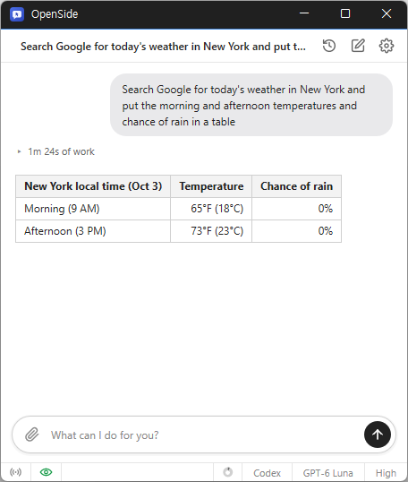

# OpenSide

**やりたいことをチャットで書くだけで、いま使っている Chrome・Edge で AI が検索からクリック・入力まで代わりにこなす、Windows 用の無料 AI アシスタント。**

[English](README.md) · [한국어](README.ko.md) · [简体中文](README.zh-CN.md) · 日本語 · [Español](README.es.md) · [Português (Brasil)](README.pt-BR.md) · [Français](README.fr.md)

> この文書は翻訳版です。内容に相違がある場合は[韓国語版](README.ko.md)が正となります。

-0078D4)

## 概要

Web でする作業には、手間はかかるのに頭はあまり使わないものがたくさんあります。いくつものショップの価格を表にまとめる、同じフォームを何度も入力する、ブログに記事を投稿する、メールボックスから必要なメールを探す、といった作業です。

OpenSide は、そうした作業をチャット 1 行で任せるプログラムです。「何をお手伝いしましょうか?」欄にやりたいことを書くと、AI がブラウザーでサイトを開き、ページを読み、ボタンを押し、文字を入力して最後まで処理し、結果を短く伝えます。集めたデータは Excel ファイルで受け取れます。

別のブラウザーを使うのではなく、**いま使っている Chrome や Edge で**作業します。すでにログインしているサイトはログインし直す必要がなく、AI は自分用のタブを開いて作業するので、その間もほかのタブを使い続けられます。Telegram と連携しておけば、外出先からスマートフォンで作業を頼み、結果を受け取ることもできます。

AI は、お持ちの ChatGPT アカウントでサインインするか、Claude・OpenAI・Gemini の API キーを入れて使います。

## 主な機能

- **チャットで Web 作業** — やりたいことを書くと、AI が検索・クリック・入力・ページ移動を代わりに行い、結果を伝えます。
- **自分のブラウザーとログインをそのまま** — 使用中の Chrome・Edge に接続して作業するので、ログイン済みのサイトをすぐ使えます。
- **繰り返し作業の自動化** — フォーム入力や複数ページからのデータ収集のように、同じことを何度も行う作業をまとめて任せられます。
- **Excel に保存** — 集めたデータを Excel(.xlsx)ファイルにします。頼めば CSV でも受け取れます。
- **Telegram リモート** — スマートフォンの Telegram で作業を頼み、回答とファイルを受け取ります。ボットを自分で作る必要はありません。
- **ファイル添付** — 画像・テキスト・CSV ファイルを添付して読ませたり、そのファイルをサイトにアップロードさせたりできます。
- **見たものを覚える** — オンにしておくと、読んだページと使ったプログラムを記録しておき、「昨日見たあの記事」のような質問に使います。
- **よく使うサイトに強い** — NAVER ブログ・Tistory・Blogger への投稿、Gmail、Google ドキュメント・スプレッドシート、Notion、Slack、YouTube、NAVER 不動産などは、サイトに合わせた方法でより速く正確に処理します。
- **複数の AI アカウント** — ChatGPT(Codex)のサインインと Claude・OpenAI・Gemini の API キーを登録しておき、チャット画面ですぐ切り替えて使えます。
- **ダークモード · 9 言語** — 韓国語・英語・日本語・中国語・ロシア語・イタリア語・フランス語・スペイン語・アラビア語。

## ダウンロード / インストール

| 種類 | リンク |
|---|---|
| インストール版 | [ダウンロード](https://down.kilho.net/openside?lang=ja) |
| ポータブル版 (ZIP) | [ダウンロード](https://down.kilho.net/openside?lang=ja&nosetup) |

インストール版は、インストールが終わるとすぐ OpenSide を起動します。ポータブル版は ZIP を展開して `OpenSide.exe` を実行するだけです。両方の機能は同じで、**ログイン時に実行** の初期値だけが違います — インストール版はオン、ポータブル版はオフです。

## 使い方

### はじめての使い方

1. OpenSide を起動します。初回起動時には、ブラウザー(Chrome または Edge)に接続設定ページが自動で開きます。
2. そのページで **Remote debugging** チェックボックスをオンにします。ページが開かなかった場合は、ブラウザーのアドレスバーに `chrome://inspect/#remote-debugging`(Edge は `edge://inspect/#remote-debugging`)を入力してください。
3. ブラウザーに接続要求が表示されたら **許可** をクリックします。この設定は一度だけで済みます。
4. 続いて **環境設定** の **アカウント** が開きます。**追加** をクリックして使う AI を選び(例: **Codex にサインイン**)、ブラウザーに開くサインイン画面でサインインします。「サインインが完了しました」と表示されたら、そのウインドウを閉じて OpenSide に戻ります。
5. チャット欄(「何をお手伝いしましょうか?」)にやりたいことを書いて **Enter** を押します。例: 「kilho.net のお知らせから最新 5 件のタイトルを教えて」
6. AI が作業している間、進行状況が 1 行ずつ表示されます。終わると結果が回答として表示され、進行状況は「N秒の作業」の 1 行にたたまれます。クリックすると再び展開できます。

### 画面構成

| 要素 | 役割 |
|---|---|
| チャットのタイトル | いまの会話のタイトル。最初のメッセージから自動で付き、クリックするとその場で変更できます(**Enter** で保存 · **Esc** で取り消し) |
| **最近のセッション** | 過去の会話の一覧(最新 15 件)。選んで続きから作業できます |
| **新しいチャット** | 新しい会話を始めます |
| **設定** | **環境設定** ウインドウを開きます |
| クリップ ボタン(**ファイルを添付**) | メッセージにファイルを添付します。添付したファイルは入力欄の下に表示され、× で外せます |
| 入力欄 · **送信** | やりたいことを書いて送ります。作業中は **送信** が **中止** に変わります |
| **リモート操作** アイコン | Telegram リモートをオン/オフします。オンのときは緑色です |
| 目のアイコン(**記録**) | ページの記録がオンのときだけ表示されます。クリックすると記録を一時停止または再開します |
| 使用量リング | **Codex にサインイン** アカウントの使用量。マウスを乗せると残量が表示されます |
| アカウント · モデル · 推論レベル | この会話で使う AI アカウント、モデル、どれだけ深く考えるかを選びます |

### こんなときは

**複数サイトの情報を表にまとめる**
「ノートパソコン A モデルの価格をショップ 3 か所で調べて Excel にまとめて」のように、集める内容と受け取る形を一緒に書きます。終わるとチャットに **⬇ ダウンロード** カードが表示されます。クリックすると保存先を尋ね(最初はダウンロード フォルダー)、保存後は **ファイルを開く** · **フォルダーを開く** ですぐ開けます。Excel ファイルは `007` や電話番号のように先頭に 0 がある値もそのまま保ちます。ほかのプログラムに入れるファイルが必要なら「CSV で」と書いてください — 文字化けしないように作ります。

**同じフォームを何度も入力する**
「このリストのとおりに申込書を 1 件ずつ送信して」のように頼みます。AI はフォームの入力欄・チェックボックス・選択リストを一度に埋め、送信ボタンを二度押さないよう結果が表示されたことを確認してから次に進みます。リストがファイルにあるなら、そのファイルを添付して送ってください。

**見るだけにしたいとき、最後まで任せたいとき**
「比較して」「下書きだけ書いて」のように書くと、AI は送信・決済・削除・公開のような取り消せないことはしません。逆に「送って」「注文して」のように任せたことは、改めて確認せずに最後のボタンまで押します。任せる範囲を文の中ではっきり書くのがおすすめです。

**ブログに記事を投稿する**
「この内容で NAVER ブログに記事を書いて公開して」のように頼みます。NAVER ブログ・Tistory・Blogger では、タイトル・本文・小見出し・画像・タグをサイトに合った方法で入れます。載せる画像はファイルとして添付してください。

**メール・ドキュメント・業務ツールを扱う**
「Gmail で先週の見積もりメールを探して要約して」「Google スプレッドシートの B 列の値を読んで」「Notion の議事録ページに今日の内容を追加して」「Slack の #お知らせ チャンネルの最新投稿を教えて」のように頼みます。ブラウザーにログインしているアカウントでそのまま作業します。Google アカウントが複数ログインしているときは、どのアカウントかを一緒に書けばそのアカウントで作業します。

**YouTube・X・LinkedIn で情報を探す**
「この YouTube 動画の字幕を要約して」「この動画のコメントの反応をまとめて」「X でこのテーマの最近の投稿を集めて」「LinkedIn でこの会社の求人を探して」のように頼みます。

**不動産物件を集める**
「NAVER 不動産で ○○ アパートのチョンセ物件を Excel にまとめて」のように頼むと、物件一覧を表にします。

**画像を探す**
「○○ の写真を 10 枚探してアドレスを集めて」のように頼むと、画像検索の結果から画像のアドレスを集めます。

**作業中にほかのタブを使う**
AI は自分が作業しているタブの中でだけ動くので、その間も同じブラウザーのほかのタブで自分の作業を続けられます。作業中のタブは裏にあっても前面にあるときと同じように動きます。同じ会話で次の作業を頼むと、ほかのタブを見ていても作業していたタブで続けます。新しい会話は、いま見ているタブから始まります。

**AI が開いたタブと自分のタブ**
AI は 2 つのページを同時に見る必要があるときだけ新しいタブを開き、回答する前に自分で開いたタブを閉じます。自分で開いておいたタブは閉じません。自分のタブを整理したいときは「kilho.net のタブを全部閉じて」のように直接頼んでください。

**認証番号・銀行アプリの承認が必要なとき**
スマートフォンの認証番号、銀行アプリの承認、文字の画像認証のように人の手が必要な段階になると、AI はそのタブを前面に出し、何をしてほしいかを 1 行で伝えます。ブラウザーで直接処理するか、認証番号をチャット欄に書いて送れば、AI が続きを進めます。「私はロボットではありません」チェックボックスは AI が自分で押し、画像を選ぶ問題が出たときだけ引き渡します。登録時にメールで届いた認証リンクやコードが必要なら、ブラウザーで Gmail にログインしていれば AI がメールボックスを開いて探してきます。

**作業の途中で言い足す**
AI が作業している最中でも、チャット欄に書いて送れます。そのメッセージは進行中の作業にそのまま伝わります。「価格はウォンで書いて」のように方向を変えたり、聞かれた値を伝えたりするときに使います。やめさせるには **中止** をクリックします。

**PC のファイルを読ませる、サイトにアップロードする**
クリップ ボタンでファイルを添付して送ると、AI がそのファイルを読みます。画像(png · jpg · gif · webp)は内容を見て、テキストと CSV は読み取って使います。一度に複数添付でき、元のファイルには手を触れません。「添付した写真をこの掲示板の投稿に添付して」のように頼むと、サイトのファイル アップロード画面まで AI が処理します。

**決まったフォルダーのファイルをいつでも読ませる**
毎回添付するのが面倒なら、**環境設定** → **ファイル** の **AI が読み取れるフォルダー** にフォルダーを入れておきます(**フォルダーを追加...**)。すると「資料フォルダーの顧客リストで…」のように頼めます。AI はそのフォルダーを読むだけで、書き込みはしません。本当に必要なフォルダーだけを入れてください。

**前に見たページをもう一度探す**
**環境設定** → **記録** で **閲覧したページと使用したアプリを記録** をオンにしておくと、読んだページの文章と使っていたプログラムのウインドウを記録しておきます。すると「昨日読んだ投資の記事をもう一度要約して」「さっき見たホテルの長所と短所を比べて」のように頼めます。記録は 30 日間残り、パスワード入力欄があるページは記録しません。記録しないサイトとプログラムはカンマ区切りで書いておきます(例: `bank.com, kakaotalk.exe`)。記録を一時的に止めるにはチャット画面の目のアイコンをクリックし、すべて消すには **すべて削除** をクリックします。この機能は最初はオフです。

**前に訪れたサイトを探す**
「前に入ったあの花屋さんのサイトを開いて」のように頼むと、ブラウザーの閲覧履歴から探して開きます。

**外出先からスマートフォンで作業を頼む(Telegram)**
1. **環境設定** → **リモート** で **連携する** をクリックします。QR コードと連携コードが表示され、10 分間使えます。
2. スマートフォンのカメラで QR を読み取ります。Telegram が開いたら **開始** をタップします。PC に Telegram がインストールされていれば **この PC で開く** をクリックしてもかまいません。
3. Telegram に接続されたというメッセージが届けば完了です。あとは Telegram でやりたいことを文字で送ると、PC の OpenSide が作業して回答を送ってきます。

作成したファイルや「認証番号を入力してください」のような依頼もスマートフォンに届きます。認証番号を Telegram で返信すると、進行中の作業に伝わります。回答が長いときは、冒頭がメッセージで、全文がファイルで届きます。Telegram では文字だけを受け付けるので、写真ではなく文字で送ってください。PC の OpenSide が起動していないと作業できないので、リモートを使うときは **ログイン時に実行** をオンにしておくと便利です。リモートを一時的にオフにするにはチャット画面の **リモート操作** アイコンをクリックし、完全に切るには **連携を解除** をクリックします。

**AI アカウントを複数使う**
**環境設定** → **アカウント** で **追加** をクリックすると、選べる種類が表示されます。

| 種類 | 使い方 |
|---|---|
| **Codex にサインイン** | ChatGPT アカウントでサインイン |
| **Claude API キー...** · **Gemini API キー...** | API キーを入れて使います |
| **OpenAI API キー...** | API キーと **ベース URL (.../v1)** を入れます。アドレスを変えれば、OpenAI と同じ方式のほかのサービスも使えます |

API キーのアカウントは、保存するときにモデル一覧をすぐ取得して確認します。新しい会話で使うアカウントは **既定にする** で決め、アカウント名はダブルクリックで変更します。会話中は、チャット画面の下でアカウント・モデル・推論レベルをすぐ切り替えられます。推論レベルを上げるとより深く考え、下げるとより速く答えます。

**使用量がどれだけ残っているか見る**
**Codex にサインイン** アカウントを使うと、チャット画面の下に使用量リングが表示されます。使うほど満ちていき、マウスを乗せると期間ごとの残量が表示されます。ほとんど使い切ったら、ほかのアカウントに切り替えて使ってください。

**過去の会話の続きをする**
**最近のセッション** をクリックすると、最近の会話 15 件がいつ使ったかと一緒に表示されます。選んで続きを頼めば OK です。タイトルを分かりやすく変えるには、上部のタイトルをクリックします。

**自動で覚えること**
AI は作業を終えるたびに、サイトの使い方や伝えた事実のように確認できた内容を覚えておき、次の会話で使います。同じサイトの作業を頼むほど迷わなくなります。

**ウインドウを閉じても起動したままにする**
ウインドウの × をクリックしても終了せず、通知領域(トレイ)に入ります。トレイ アイコンをクリックするとウインドウが再び表示されます。完全に終了するには、トレイ アイコンを右クリックして **終了** をクリックします。同じメニューの **起動時に実行** は **環境設定** の **ログイン時に実行** と同じ設定で、オンにしておくと Windows の起動時にトレイで静かに起動します。OpenSide は 1 つだけ起動し、もう一度起動するとすでに開いているウインドウが前面に出ます。

**OpenSide のウインドウを常に前面に置く**
ブラウザーの横に OpenSide を出して見ながら使うなら、**環境設定** → **一般** で **常に手前に表示** を **オン** にします。ウインドウの位置とサイズは記憶され、次回も同じ場所に開きます。

**Chrome と Edge のどちらで作業させるか**
OpenSide は **Remote debugging** をオンにしたブラウザーで作業します。両方オンなら Windows の既定のブラウザーを先に使います。もう一方で作業させたいときは、そのブラウザーでだけオンにしておいてください。

**ブラウザーを再起動したとき**
接続が必要になると、OpenSide が **ブラウザーとの接続が必要です** ウインドウで手順を順番に案内します。そのとおりに操作してから **接続** をクリックしてください。ウインドウに書かれたアドレスはクリックするとコピーされるので、アドレスバーに貼り付ければ OK です。

## 設定

**設定** ボタンをクリックすると **環境設定** ウインドウが開きます。変更はすぐ反映されます。

| タブ | 項目 |
|---|---|
| **一般** | **常に手前に表示** · **テーマ**(自動 · ライト · ダーク) · **言語**(自動または 9 言語のいずれか) · **ログイン時に実行** |
| **アカウント** | AI アカウントの追加 · 削除 · サインイン · 既定のアカウントの設定 |
| **リモート** | Telegram の連携 · 連携解除 |
| **記録** | 閲覧したページとアプリの記録のオン · 一時停止 · 記録しないサイトとアプリ · すべて削除 |
| **ファイル** | AI が読み取れるフォルダー |

**言語** が **自動** なら Windows の表示言語に従います。アラビア語を選ぶと画面が右から左になります。AI の進行状況と回答は、自分が書いたメッセージの言語に従います。**テーマ** が **自動** なら Windows のアプリ モード(ライト · ダーク)に従います。

## 動作環境

- Windows 10 · Windows 11 (64 ビット)
- Google Chrome または Microsoft Edge
- ChatGPT アカウント、または Claude・OpenAI・Gemini の API キー
- インターネット接続

## アップデート

OpenSide は、セキュリティとウイルス対策ソフトの誤検知防止のため、自動では更新**しません**。起動時に新しいバージョンがあるか確認して案内し、入手を選ぶとダウンロード ページを開いてプログラムを閉じます。新しいバージョンは社内検証を経て手動で配布され、[OpenSide のページ](https://kilho.net/openside)で告知されます。[アップデート ポリシーのお知らせ](https://en.kilho.net/archives/notice/2940)をご覧ください。

## ライセンス

OpenSide は**フリーウェア**です。会社、家庭、官公庁、学校など、どこでも制限なく無料で使え、自由に再配布できます。AI の利用料金は、各自が使う AI アカウント・API キーの料金プランに従います。

## リンク

- Web サイト: <https://kilho.net/openside>
- フォーラム: <https://kilho.top/forum/qna>
- X (Twitter): <https://www.twitter.com/kilhonet>

© KILHO.NET
