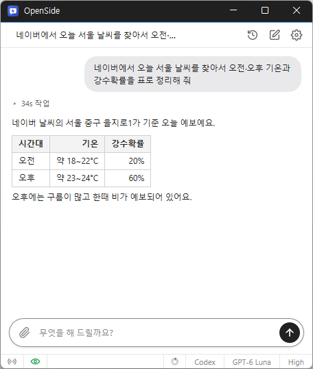

# OpenSide

**원하는 일을 채팅으로 적으면, AI 가 지금 쓰고 있는 크롬·엣지에서 검색부터 클릭·입력까지 대신 해 주는 Windows 무료 AI 비서.**

[English](README.md) · 한국어 · [简体中文](README.zh-CN.md) · [日本語](README.ja.md) · [Español](README.es.md) · [Português (Brasil)](README.pt-BR.md) · [Français](README.fr.md)

-0078D4)

## 개요

웹에서 하는 일 중에는 손은 많이 가는데 머리는 별로 안 쓰는 일이 많습니다. 여러 쇼핑몰의 가격을 표로 모으기, 같은 양식을 여러 번 채우기, 블로그에 글 올리기, 메일함에서 필요한 메일 찾기 같은 일입니다.

OpenSide 는 그런 일을 채팅 한 줄로 맡기는 프로그램입니다. "무엇을 해 드릴까요?" 칸에 하고 싶은 일을 적으면 AI 가 브라우저에서 사이트를 열고, 페이지를 읽고, 버튼을 누르고, 글자를 입력해 끝까지 처리한 뒤 결과를 짧게 알려 줍니다. 모은 자료는 엑셀 파일로 받을 수 있습니다.

새 브라우저를 따로 쓰는 것이 아니라 **지금 쓰고 있는 크롬이나 엣지에서** 일합니다. 이미 로그인해 둔 사이트는 다시 로그인할 필요가 없고, AI 는 따로 탭을 열어 일하므로 그동안 다른 탭을 계속 써도 됩니다. 텔레그램을 연동해 두면 밖에서 폰으로 일을 시키고 결과를 받을 수도 있습니다.

AI 는 가지고 있는 ChatGPT 계정으로 로그인하거나 Claude · OpenAI · Gemini API 키를 넣어 씁니다.

## 주요 기능

- **채팅으로 웹 작업** — 하고 싶은 일을 적으면 AI 가 검색 · 클릭 · 입력 · 페이지 이동을 대신 하고 결과를 알려 줍니다.
- **내 브라우저와 로그인 그대로** — 사용 중인 크롬 · 엣지에 붙어서 일하므로 로그인해 둔 사이트를 바로 씁니다.
- **반복 작업 자동화** — 양식 채우기, 여러 페이지에서 자료 모으기처럼 같은 일을 여러 번 하는 작업을 한 번에 맡깁니다.
- **엑셀로 저장** — 모은 자료를 엑셀(.xlsx) 파일로 만들어 줍니다. 원하면 CSV 로도 받습니다.
- **텔레그램 원격** — 폰의 텔레그램으로 일을 시키고 답과 파일을 받습니다. 봇을 직접 만들 필요가 없습니다.
- **파일 붙이기** — 이미지 · 텍스트 · CSV 파일을 붙여 읽히거나, 그 파일을 사이트에 올리게 할 수 있습니다.
- **본 것 기억하기** — 켜 두면 내가 읽은 페이지와 쓴 프로그램을 기록해 두었다가 "어제 본 그 글" 같은 질문에 씁니다.
- **자주 쓰는 사이트에 강함** — 네이버 블로그 · 티스토리 · 블로거 글쓰기, Gmail, 구글 문서 · 시트, 노션, 슬랙, 유튜브, 네이버 부동산 등은 사이트에 맞춘 방법으로 더 빠르고 정확하게 처리합니다.
- **여러 AI 계정** — ChatGPT(Codex) 로그인과 Claude · OpenAI · Gemini API 키를 등록해 두고 채팅 화면에서 바로 바꿔 씁니다.
- **다크 모드 · 9개 언어** — 한국어 · 영어 · 일본어 · 중국어 · 러시아어 · 이탈리아어 · 프랑스어 · 스페인어 · 아랍어.

## 다운로드 / 설치

| 종류 | 링크 |
|---|---|
| 설치판 | [다운로드](https://down.kilho.net/openside?lang=ko) |
| 무설치판 (ZIP) | [다운로드](https://down.kilho.net/openside?lang=ko&nosetup) |

설치판은 설치가 끝나면 OpenSide 를 바로 실행합니다. 무설치판은 ZIP 을 풀고 `OpenSide.exe` 를 실행하면 됩니다. 두 판의 기능은 같고, **시작할 때 실행** 의 처음 값만 다릅니다 — 설치판은 켜져 있고 무설치판은 꺼져 있습니다.

## 사용법

### 처음 사용하기

1. OpenSide 를 실행합니다. 처음 실행하면 브라우저(크롬 또는 엣지)에 연결 설정 페이지가 저절로 열립니다.
2. 그 페이지에서 **Remote debugging** 체크 상자를 켭니다. 페이지가 열리지 않았다면 브라우저 주소창에 `chrome://inspect/#remote-debugging` (엣지는 `edge://inspect/#remote-debugging`)을 입력하세요.
3. 브라우저에 연결 요청이 나타나면 **허용** 을 누릅니다. 이 설정은 한 번만 하면 됩니다.
4. 이어서 **환경설정** 의 **계정** 이 열립니다. **추가** 를 눌러 쓸 AI 를 고르고(예: **Codex 로그인**), 브라우저에 열리는 로그인 화면에서 로그인합니다. "로그인이 완료되었습니다" 가 보이면 그 창을 닫고 OpenSide 로 돌아옵니다.
5. 채팅 칸("무엇을 해 드릴까요?")에 할 일을 적고 **Enter** 를 누릅니다. 예: "kilho.net 공지사항에서 최근 글 5개 제목 알려 줘"
6. AI 가 일하는 동안 진행 상황이 한 줄씩 보입니다. 끝나면 결과가 답으로 나오고, 진행 상황은 "N초 작업" 한 줄로 접힙니다. 눌러서 다시 펼쳐 볼 수 있습니다.

### 화면 구성

| 요소 | 역할 |
|---|---|
| 채팅 제목 | 지금 대화의 제목. 첫 메시지로 저절로 붙고, 누르면 바로 고칠 수 있습니다 (**Enter** 저장 · **Esc** 취소) |
| **최근 세션** | 지난 대화 목록(최근 15개). 골라서 이어서 할 수 있습니다 |
| **새 채팅** | 새 대화를 시작합니다 |
| **설정** | **환경설정** 창을 엽니다 |
| 클립 단추 (**파일 붙이기**) | 메시지에 파일을 붙입니다. 붙인 파일은 입력칸 아래에 보이고 × 로 뺄 수 있습니다 |
| 입력칸 · **보내기** | 할 일을 적고 보냅니다. 일하는 동안에는 **보내기** 가 **중단** 으로 바뀝니다 |
| **원격 제어** 아이콘 | 텔레그램 원격을 켜고 끕니다. 켜져 있으면 초록색입니다 |
| 눈 아이콘 (**기록**) | 본 페이지 기록이 켜져 있을 때만 보입니다. 누르면 기록을 잠시 멈추거나 다시 시작합니다 |
| 사용량 고리 | **Codex 로그인** 계정의 사용량. 마우스를 올리면 남은 양이 보입니다 |
| 계정 · 모델 · 추론 레벨 | 이 대화에 쓸 AI 계정, 모델, 생각을 얼마나 깊게 할지를 고릅니다 |

### 이럴 때 이렇게

**여러 사이트의 정보를 표로 모으기**
"노트북 A 모델 가격을 쇼핑몰 세 곳에서 찾아서 엑셀로 정리해 줘" 처럼 모을 내용과 받을 형태를 함께 적습니다. 다 되면 채팅에 **⬇ 다운로드** 카드가 나옵니다. 누르면 저장 위치를 묻고(처음에는 다운로드 폴더), 저장한 뒤에는 **파일열기** · **폴더열기** 로 바로 열 수 있습니다. 엑셀 파일은 `007` 이나 전화번호처럼 앞자리 0 이 있는 값도 그대로 지킵니다. 다른 프로그램에 넣을 파일이 필요하면 "CSV 로" 라고 적으세요 — 한글이 깨지지 않게 만들어 줍니다.

**같은 양식을 여러 번 채우기**
"이 목록대로 신청서를 하나씩 제출해 줘" 처럼 시킵니다. AI 는 양식의 칸 · 체크 상자 · 선택 목록을 한 번에 채우고, 제출 버튼을 두 번 누르지 않도록 결과가 나타나는지 확인한 뒤 다음으로 넘어갑니다. 목록이 파일에 있으면 파일을 붙여 보내면 됩니다.

**읽기만 시키고 싶을 때, 끝까지 맡기고 싶을 때**
"비교해 줘", "초안만 써 줘" 처럼 적으면 AI 는 보내기 · 결제 · 삭제 · 게시 같은 되돌릴 수 없는 일은 하지 않습니다. 반대로 "보내 줘", "주문해 줘" 처럼 맡긴 일은 다시 묻지 않고 마지막 버튼까지 누릅니다. 맡길 범위를 문장에 분명히 적는 것이 좋습니다.

**블로그에 글 올리기**
"이 내용으로 네이버 블로그에 글 써서 발행해 줘" 처럼 시킵니다. 네이버 블로그 · 티스토리 · 블로거는 제목 · 본문 · 소제목 · 이미지 · 태그를 사이트에 맞는 방법으로 넣습니다. 올릴 이미지는 파일로 붙이면 됩니다.

**메일 · 문서 · 업무 도구 다루기**
"Gmail 에서 지난주 견적 메일 찾아서 요약해 줘", "구글 시트의 B열 값 읽어 줘", "노션 회의록 페이지에 오늘 내용 추가해 줘", "슬랙 #공지 채널 최근 글 알려 줘" 처럼 시킵니다. 브라우저에 로그인된 계정으로 바로 일합니다. 구글 계정이 여러 개 로그인되어 있으면 어느 계정인지 함께 적으면 그 계정에서 일합니다.

**유튜브 · X · 링크드인에서 자료 찾기**
"이 유튜브 영상 자막 요약해 줘", "이 영상 댓글 반응 정리해 줘", "X 에서 이 주제 최근 글 모아 줘", "링크드인에서 이 회사 채용 공고 찾아 줘" 처럼 시킵니다.

**부동산 매물 모으기**
"네이버 부동산에서 ○○아파트 전세 매물을 엑셀로 정리해 줘" 처럼 시키면 매물 목록을 표로 만들어 줍니다.

**이미지 찾기**
"○○ 사진 10장 찾아서 주소 모아 줘" 처럼 시키면 이미지 검색 결과에서 이미지 주소를 모읍니다.

**일하는 동안 다른 탭 쓰기**
AI 는 자기가 일하는 탭에서만 움직이므로, 그동안 같은 브라우저의 다른 탭에서 하던 일을 계속해도 됩니다. 일하는 탭이 뒤에 있어도 앞에 있을 때처럼 돌아갑니다. 같은 대화에서 다음 일을 시키면 다른 탭을 보고 있더라도 하던 탭에서 이어 갑니다. 새 대화는 지금 보고 있는 탭에서 시작합니다.

**AI 가 연 탭과 내 탭**
AI 는 두 페이지를 동시에 봐야 할 때만 새 탭을 열고, 답하기 전에 자기가 연 탭을 닫습니다. 내가 열어 둔 탭은 닫지 않습니다. 내 탭을 정리하고 싶으면 "kilho.net 탭 전부 닫아 줘" 처럼 직접 시키면 됩니다.

**인증번호 · 은행 앱 승인이 필요할 때**
휴대폰 인증번호, 은행 앱 승인, 글자 보안문자처럼 사람 손이 필요한 단계가 나오면 AI 가 그 탭을 앞으로 띄우고 무엇을 해 달라는지 한 줄로 알려 줍니다. 브라우저에서 직접 처리하거나, 인증번호를 채팅 칸에 적어 보내면 AI 가 이어서 진행합니다. "로봇이 아닙니다" 체크 상자는 AI 가 직접 누르고, 그림을 고르는 문제가 나올 때만 넘겨 줍니다. 가입할 때 메일로 온 인증 링크나 코드가 필요하면, 브라우저에 Gmail 이 로그인되어 있을 경우 AI 가 메일함을 열어 찾아옵니다.

**일하는 도중에 말 보태기**
AI 가 일하는 중에도 채팅 칸에 적어 보낼 수 있습니다. 그 말은 진행 중인 작업에 그대로 전달됩니다. "가격은 원화로 적어 줘" 처럼 방향을 바꾸거나, 물어본 값을 알려 줄 때 씁니다. 그만두게 하려면 **중단** 을 누릅니다.

**내 PC 의 파일을 읽히거나 사이트에 올리기**
클립 단추로 파일을 붙여 보내면 AI 가 그 파일을 읽습니다. 이미지(png · jpg · gif · webp)는 내용을 보고, 텍스트와 CSV 는 읽어서 씁니다. 여러 개를 한 번에 붙일 수 있고, 원본 파일은 건드리지 않습니다. "붙인 사진을 이 게시판 글에 첨부해 줘" 처럼 시키면 사이트의 파일 올리기 창까지 AI 가 처리합니다.

**정해 둔 폴더의 파일을 늘 읽게 하기**
매번 붙이기 번거로우면 **환경설정** → **파일** 에서 **AI 가 읽을 수 있는 폴더** 에 폴더를 넣어 둡니다(**폴더 추가...**). 그러면 "자료 폴더의 고객 목록으로 …" 처럼 시킬 수 있습니다. AI 는 그 폴더를 읽기만 하고 쓰지 않습니다. 꼭 필요한 폴더만 넣으세요.

**전에 본 페이지 다시 찾기**
**환경설정** → **기록** 에서 **내가 본 페이지와 앱 기록** 을 켜 두면, 내가 읽은 페이지의 글과 쓰던 프로그램 창을 기록해 둡니다. 그러면 "어제 읽은 투자 글 다시 요약해 줘", "아까 본 호텔들 장단점 비교해 줘" 처럼 시킬 수 있습니다. 기록은 30일 동안 남고, 비밀번호 입력칸이 있는 페이지는 기록하지 않습니다. 기록하지 않을 사이트와 프로그램은 쉼표로 적어 둡니다(예: `bank.com, kakaotalk.exe`). 잠시 기록을 멈추려면 채팅 화면의 눈 아이콘을 누르고, 모두 지우려면 **전부 지우기** 를 누릅니다. 이 기능은 처음에는 꺼져 있습니다.

**전에 들른 사이트 찾기**
"지난번에 들어갔던 그 꽃집 사이트 열어 줘" 처럼 시키면 브라우저 방문 기록에서 찾아 엽니다.

**밖에서 폰으로 일 시키기 (텔레그램)**
1. **환경설정** → **원격** 에서 **연동하기** 를 누릅니다. QR 코드와 연동 코드가 나오고, 10분 동안 쓸 수 있습니다.
2. 폰 카메라로 QR 을 찍습니다. 텔레그램이 열리면 **시작** 을 누릅니다. PC 에 텔레그램이 설치되어 있으면 **이 PC 에서 열기** 를 눌러도 됩니다.
3. 텔레그램에 연결되었다는 메시지가 오면 끝입니다. 이제 텔레그램에 할 일을 글로 보내면 PC 의 OpenSide 가 일하고 답을 보내 줍니다.

만든 파일과 "인증번호를 입력해 주세요" 같은 요청도 폰으로 옵니다. 인증번호는 텔레그램으로 답하면 진행 중인 작업에 전달됩니다. 답이 길면 앞부분은 메시지로, 전문은 파일로 옵니다. 텔레그램으로는 글만 받으므로 사진 대신 글로 보내 주세요. PC 의 OpenSide 가 켜져 있어야 일할 수 있으므로, 원격을 쓸 때는 **시작할 때 실행** 을 켜 두면 편합니다. 잠시 원격을 끄려면 채팅 화면의 **원격 제어** 아이콘을 누르고, 완전히 끊으려면 **연동 해제** 를 누릅니다.

**AI 계정을 여러 개 쓰기**
**환경설정** → **계정** 에서 **추가** 를 누르면 고를 수 있는 종류가 나옵니다.

| 종류 | 쓰는 방법 |
|---|---|
| **Codex 로그인** | ChatGPT 계정으로 로그인 |
| **Claude API 키...** · **Gemini API 키...** | API 키를 넣어 씁니다 |
| **OpenAI API 키...** | API 키와 **주소 (.../v1)** 를 넣습니다. 주소를 바꾸면 OpenAI 와 같은 방식의 다른 서비스도 쓸 수 있습니다 |

API 키 계정은 저장할 때 모델 목록을 바로 받아 와 확인합니다. 새 대화에 쓸 계정은 **기본으로** 로 정하고, 계정 이름은 두 번 눌러 바꿉니다. 대화 중에는 채팅 화면 아래쪽에서 계정 · 모델 · 추론 레벨을 바로 바꿀 수 있습니다. 추론 레벨을 높이면 더 깊게 생각하고, 낮추면 더 빨리 답합니다.

**사용량이 얼마나 남았는지 보기**
**Codex 로그인** 계정을 쓰면 채팅 화면 아래쪽에 사용량 고리가 보입니다. 많이 쓸수록 차오르고, 마우스를 올리면 기간별로 남은 양이 보입니다. 거의 다 썼으면 다른 계정으로 바꿔 쓰면 됩니다.

**지난 대화 이어 하기**
**최근 세션** 을 누르면 최근 대화 15개가 언제 썼는지와 함께 나옵니다. 골라서 이어서 시키면 됩니다. 제목을 알아보기 쉽게 바꾸려면 위쪽 제목을 누릅니다.

**알아서 기억하는 것**
AI 는 일을 마칠 때마다 사이트 쓰는 법이나 내가 알려 준 사실처럼 확인된 내용을 따로 기억해 두었다가 다음 대화에서 씁니다. 같은 사이트 일을 다시 시킬수록 덜 헤맵니다.

**창을 닫아도 계속 켜 두기**
창의 × 를 누르면 끝나지 않고 알림 영역(트레이)으로 들어갑니다. 트레이 아이콘을 누르면 창이 다시 나옵니다. 완전히 끝내려면 트레이 아이콘을 오른쪽 클릭하고 **종료하기** 를 누릅니다. 같은 메뉴의 **부팅시 실행** 은 **환경설정** 의 **시작할 때 실행** 과 같은 설정이고, 켜 두면 Windows 를 켤 때 트레이에서 조용히 시작합니다. OpenSide 는 하나만 실행되며, 다시 실행하면 이미 켜진 창이 앞으로 나옵니다.

**OpenSide 창을 늘 앞에 두기**
브라우저 옆에 OpenSide 를 띄워 두고 보며 쓰려면 **환경설정** → **일반** 에서 **항상 위** 를 **사용함** 으로 바꿉니다. 창 위치와 크기는 기억되어 다음에도 그 자리에 열립니다.

**크롬과 엣지 중 어느 쪽에서 일할지**
OpenSide 는 **Remote debugging** 을 켠 브라우저에서 일합니다. 둘 다 켜져 있으면 Windows 기본 브라우저를 먼저 씁니다. 다른 쪽에서 일하게 하려면 그 브라우저에서만 켜 두면 됩니다.

**브라우저를 껐다 켰을 때**
연결이 필요하면 OpenSide 가 **브라우저 연결이 필요해요** 창으로 할 일을 순서대로 알려 줍니다. 그대로 따라 한 뒤 **연결하기** 를 누르면 됩니다. 창에 적힌 주소는 누르면 복사되므로 주소창에 붙여 넣으면 됩니다.

## 설정

**설정** 단추를 누르면 **환경설정** 창이 열립니다. 바꾼 값은 바로 적용됩니다.

| 탭 | 항목 |
|---|---|
| **일반** | **항상 위** · **테마**(자동 · 라이트 · 다크) · **언어**(자동 또는 9개 언어 중 하나) · **시작할 때 실행** |
| **계정** | AI 계정 추가 · 삭제 · 로그인 · 기본 계정 정하기 |
| **원격** | 텔레그램 연동 · 연동 해제 |
| **기록** | 본 페이지와 앱 기록 켜기 · 잠시 멈춤 · 기록하지 않을 사이트와 앱 · 전부 지우기 |
| **파일** | AI 가 읽을 수 있는 폴더 |

**언어** 가 **자동** 이면 Windows 표시 언어를 따릅니다. 아랍어를 고르면 화면이 오른쪽에서 왼쪽으로 바뀝니다. AI 의 진행 상황과 답은 내가 쓴 메시지의 언어를 따릅니다. **테마** 가 **자동** 이면 Windows 의 앱 모드(밝게 · 어둡게)를 따릅니다.

## 요구 사항

- Windows 10 · Windows 11 (64비트)
- Google Chrome 또는 Microsoft Edge
- ChatGPT 계정, 또는 Claude · OpenAI · Gemini API 키
- 인터넷 연결

## 업데이트

OpenSide 는 보안과 백신 오탐 방지를 위해 스스로 업데이트하지 **않습니다**. 실행할 때 새 버전이 있는지 확인해 안내하고, 받기로 하면 다운로드 페이지를 열고 프로그램을 닫습니다. 새 버전은 내부 검증을 거쳐 수동으로 배포되며 [OpenSide 페이지](https://kilho.net/openside)에 공지됩니다. [업데이트 정책 안내](https://kilho.net/archives/notice/2940)를 참고하세요.

## 라이선스

OpenSide 는 **프리웨어**입니다. 회사, 집, 관공서, 학교 등 어디서나 제약 없이 무료로 쓸 수 있고, 자유롭게 재배포할 수 있습니다. AI 사용료는 각자 쓰는 AI 계정 · API 키의 요금제를 따릅니다.

## 링크

- 웹사이트: <https://kilho.net/openside>
- 포럼: <https://kilho.top/forum/qna>
- X (Twitter): <https://www.twitter.com/kilhonet>

© KILHO.NET
